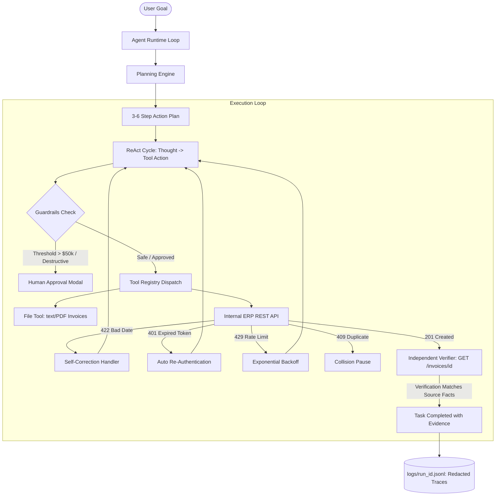

# Autonomous AI Task Worker

An autonomous, resilient, zero-heavy-framework AI agent prototype built for enterprise Accounts Payable tasks. It executes natural language goals by discovering documents, querying internal REST APIs, adapting to machine-readable errors (422, 401, 429), strictly enforcing financial approval guardrails, and independently verifying database records before declaring task completion.

---

## Architecture Overview



---

## Key Features

1. **Zero-Framework Architecture:** Handcrafted ReAct execution loop without LangChain, AutoGen, or CrewAI boilerplate. Every line of code is transparent and debuggable.
2. **Unified LLM Interface (`agent/llm.py`):** Single function `call_llm(messages, tools)` supporting Gemini (`gemini-2.5-flash`), OpenAI (`gpt-4o`), Claude (`claude-3-5-sonnet`), and deterministic offline modes.
3. **Mock Corporate ERP API (`mock_app/main.py`):**
   - Full FastAPI service with JWT Bearer authentication, vendor registries, and accounts payable invoice endpoints.
   - Dual-mode database: Runs on local PostgreSQL via `docker-compose.yml`, with automatic fallback to local SQLite for frictionless zero-setup execution.
   - Strict Pydantic format validation: Enforces ISO 8601 (`YYYY-MM-DD`).
4. **Autonomous Resilience & Self-Correction:**
   - **HTTP 422:** Analyzes machine-readable validation errors, transforms non-ISO dates (e.g. `"November 25, 2026"` $\to$ `"2026-11-25"`), and retries.
   - **HTTP 401:** Automatically detects expired tokens, calls `/auth/login`, refreshes Bearer tokens, and retries.
   - **HTTP 429 / 503:** Honors `Retry-After` headers and applies exponential backoff.
   - **HTTP 409:** Detects existing identical records and prevents accidental double-spending or duplicate writes.
5. **Mandatory Independent Verification (`agent/verifier.py`):** The agent never trusts a `201 Created` write response alone. It performs an independent `GET /invoices/{id}` and compares persisted database fields against source document facts.
6. **Deterministic Financial Guardrails (`agent/guardrails.py`):**
   - Hard policy ceiling: Any invoice exceeding **$50,000.00** requires explicit operator sign-off before submission.
   - Destructive operations (`PATCH` / `DELETE`) require explicit human authorization.
   - Loop detection terminates repeated failing actions.
   - Audit trail automatically redacts passwords and JWT tokens.

---

## Directory Structure

```
ai-task-worker/
├── agent/
│   ├── loop.py             # Core autonomous ReAct loop
│   ├── planner.py          # Initial goal decomposition & dynamic plan updates
│   ├── memory.py           # Working memory (facts, state, company rules)
│   ├── llm.py              # Unified LLM caller (Gemini/OpenAI/Claude/Mock)
│   ├── guardrails.py       # Loop detection, step limits, policy approvals
│   ├── verifier.py         # Independent GET verification engine
│   └── logger.py           # JSONL audit logger with secrets redaction
├── tools/
│   ├── files.py            # list_files & read_file (PDF via pypdf / plain text)
│   ├── api.py              # api_request tool via httpx (trimmed outputs)
│   ├── human.py            # ask_human tool (interactive prompt & eval hooks)
│   └── registry.py         # Unified tool schemas & dispatch table
├── mock_app/
│   ├── main.py             # FastAPI mock ERP API
│   ├── models.py           # SQLAlchemy ORM models & strict Pydantic schemas
│   └── failures.py         # Failure injection engine (401, 429, 500, 503)
├── data/
│   ├── invoices/           # 5 sample invoices (varying dates, vendors, formats)
│   ├── company_context.json# Operational procedures & policy thresholds
│   └── api_spec.md         # API contract documentation
├── evals/
│   └── run_evals.py        # Comprehensive 7-scenario benchmark runner
├── logs/                   # Redacted JSONL run traces
├── docker-compose.yml      # Local PostgreSQL container specification
├── requirements.txt        # Minimal Python dependencies
├── run_worker.py           # Standalone CLI runner
└── README.md
```

---

## Quick Start & Setup

### 1. Installation
Ensure Python 3.11+ is installed:
```bash
git clone <repo-url>
cd ai-task-worker
pip install -r requirements.txt
```

### 2. (Optional) Database Setup
If Docker is installed:
```bash
docker compose up -d
```
*(If Docker is not running, the system will automatically fall back to a local SQLite database without breaking).*

### 3. Running the Comprehensive Evaluation Benchmark
Execute all 7 failure recovery and verification tests across fresh database wipes:
```bash
python -m evals.run_evals
```

Scorecard output:
```
+---------------------------+------------------------------------------+----------+---------+-----------+--------------+
| Test Scenario             | Target Behavior                          | Status   |   Steps |   Retries | Run ID       |
+===========================+==========================================+==========+=========+===========+==============+
| 1. Standard Invoice Entry | End-to-End Extraction & GET Verification | PASS     |      11 |         0 | run_be15d74a |
| 2. Schema 422 Recovery    | Parse error & self-correct date format   | PASS     |       9 |         1 | run_6487e083 |
| 3. Auth 401 Recovery      | Detect stale token & re-authenticate     | PASS     |       3 |         1 | run_2d45a9dc |
| 4. Rate Limit 429         | Parse Retry-After & backoff retry        | PASS     |       5 |         1 | run_e5b748e2 |
| 5. Duplicate 409 Conflict | Detect conflict & avoid overwrite        | PASS     |       7 |         0 | run_7450d83f |
| 6. High-Value Approval    | Intercept >$50k & require human signoff  | PASS     |       7 |         0 | run_5836f380 |
| 7. Generalization Query   | Unchanged agent runs read-only task      | PASS     |       5 |         0 | run_b5ae0551 |
+---------------------------+------------------------------------------+----------+---------+-----------+--------------+
ALL 7 EVALUATION BENCHMARKS PASSED (100% SUCCESS RATE)!
```

### 4. Running Custom Tasks via CLI
To run an arbitrary task:
```bash
# Standard invoice entry
python run_worker.py --task "Find the latest invoice from Acme Cloud Solutions, extract amount and due date, enter it into our internal system, and tell me once it is done."

# Generalization query
python run_worker.py --task "List all vendors registered in the internal system"
```

---

## Technical Design & Interview Q&A

### 1. Why build your own ReAct loop instead of using LangChain or CrewAI?
> **Answer:** Frameworks like LangChain introduce hundreds of indirect abstraction layers, obscure prompt chains, and make debugging production failures nearly impossible. Building our own lightweight loop means we control the exact token context, state pruning, tool invocation schemas, and failure recovery handlers. We can inspect, debug, and explain every single line of code.

### 2. Why is independent verification necessary if the API returned 201 Created?
> **Answer:** A `201 Created` status only proves that the database accepted a valid JSON payload. It does **not** guarantee that the extracted values matched what was on the original PDF or invoice. Performing a fresh, independent `GET /invoices/{id}` call and matching every field against source extracted facts eliminates LLM hallucinations of task completion.

### 3. How does the agent self-correct without human intervention?
> **Answer:** When an invalid date format (such as `"November 25, 2026"`) is submitted, the API returns a structured HTTP `422 Unprocessable Entity` containing `detail[0].loc: ["body", "due_date"]` and `detail[0].msg: "due_date must strictly be formatted as YYYY-MM-DD"`. The agent observes this machine-readable feedback, normalizes the extracted value into ISO 8601 (`2026-11-25`), and retries the request.
